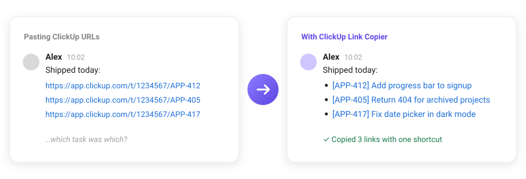

<div align="center">


# ClickUp Link Copier

**Copy ClickUp tasks as clickable titles — one at a time, or a whole batch with one shortcut.**

[Website](https://semenov-k.github.io/clickup-link-copier/) · [Report a problem](https://github.com/semenov-k/clickup-link-copier/issues)

[](LICENSE)




</div>

Pasting a ClickUp URL into Slack gives everyone a wall of `/t/1234567/APP-412`. This extension puts a **copy button on every task** and lets you **collect tasks as you browse**, so you paste titles people can actually read — and click.

## ✨ What you get

- 🔗 **One-click copy** on list rows, subtasks, board cards and the task page
- 🧺 **Collect while you browse** — <kbd>⌥ Option</kbd>/<kbd>Alt</kbd> + click any task to drop it into a list, then copy them all at once
- 👀 **See it before you paste** — the dock previews exactly what lands in the clipboard; drag to reorder
- 🏷️ **Task IDs, your call** — `[APP-412] Title` by default, custom IDs where your space has them; switch it off any time
- 📋 **Pastes right everywhere** — rich links in Slack, Notion, Google Docs and Gmail; Markdown in code editors and GitHub
- 🎨 **Feels native** — styled after ClickUp's own buttons and follows its light and dark themes
- ↩️ **Undo everything** — removing, clearing and copy-and-clear can all be undone

## 🚀 How to use it

1. **Hover a task** and click 🔗 to copy just that one. On an open task, use **Copy link** in the header.
2. **<kbd>⌥</kbd>+click tasks** in any view to collect them. A dock appears at the bottom of the page.
3. **Press <kbd>⌥</kbd><kbd>⇧</kbd><kbd>C</kbd>** (<kbd>Alt</kbd>+<kbd>Shift</kbd>+<kbd>C</kbd> on Windows/Linux) or click **Copy N links**, then paste.

One task pastes as an inline link; several paste as a bulleted list.

### Where the buttons show up

| Where | What |
| --- | --- |
| **List view** rows | Hover → 🔗 copy link, ☰+ add to list |
| **Subtasks** on a task page | Same buttons on hover, next to ClickUp's own row buttons |
| **Board view** cards | Same buttons in the card's bottom-right corner |
| **Task page** (full page or modal) | **Copy link** and **Add to list** in the header, above the title |
| **Anywhere** | <kbd>⌥</kbd>/<kbd>Alt</kbd> + click a task row, card or task link → add or remove it |
| **Dock** (bottom center) | Count, **Copy N links**, Clear. Click the count to preview what will paste: drag rows (or <kbd>Alt</kbd>+<kbd>↑</kbd>/<kbd>↓</kbd>) to reorder; hover a row to copy ⧉ or remove ✕ it. The **Task IDs** switch lives here too |
| **Toolbar popup** | Same preview, Copy / Clear, and paste settings. Active only on `app.clickup.com` |

### Keyboard

| Keys | Does |
| --- | --- |
| <kbd>⌥</kbd> + click | Add a task to the list, or remove it |
| <kbd>⌥</kbd><kbd>⇧</kbd><kbd>C</kbd> | Copy every task in the list (ignored while you're typing) |
| <kbd>Alt</kbd>+<kbd>↑</kbd> / <kbd>↓</kbd> | Move the focused task in the preview |
| <kbd>Esc</kbd> | Close the preview |

### Paste settings

Open the toolbar popup → **Paste settings**:

- **Task ID before the title** — on by default
- **Plain-text format** for apps without rich text: Markdown `[Title](url)` (default), `Title — url`, or URL only
- **Clear the list after copying** — Undo puts the copied tasks back in their original order

## 📦 Install

**[Add to Chrome from the Chrome Web Store](https://chromewebstore.google.com/detail/nkhidbpjapdgponjmgfangjbihpambak)** (the link works once the listing is approved).

Or build it from source and load it in developer mode:

```bash
git clone https://github.com/semenov-k/clickup-link-copier.git
cd clickup-link-copier
pnpm install
pnpm build
```

1. Open `chrome://extensions` and turn on **Developer mode** (top right)
2. Click **Load unpacked** and pick the `.output/chrome-mv3` folder
3. Pin the extension and refresh any open ClickUp tabs

**Updating:** `git pull && pnpm build`, click ↻ on the extension in `chrome://extensions`, then refresh ClickUp tabs.

## 🔒 Privacy & permissions

Everything stays in your browser. There's no server, no analytics, and the extension only runs on `app.clickup.com`.

| Permission | Why |
| --- | --- |
| `storage` | Keeps your collected list and settings (`chrome.storage.local`) |
| `clipboardWrite` | Copies the links |
| `declarativeContent` | Enables the toolbar button only on ClickUp, without reading the sites you visit |
| `https://app.clickup.com/*` | Adds the buttons to ClickUp pages |

## 🛠️ Development

```bash
pnpm dev        # Chrome with the extension loaded + hot reload
pnpm build      # production build → .output/chrome-mv3
pnpm zip        # zip for the Chrome Web Store
pnpm compile    # type-check
```

The landing page lives in [`site/`](site) (Vite + Tailwind + TypeScript). Its demo uses the extension's own formatter, so it copies exactly what the extension would:

```bash
cd site && pnpm install
pnpm dev        # local preview
pnpm build      # static build → site/dist
pnpm pages      # build and publish to GitHub Pages (pushes site/dist to the gh-pages branch)
```

The first time, turn on Pages for the `gh-pages` branch: **Settings → Pages → Deploy from a branch → `gh-pages` / root**, or with the GitHub CLI:

```bash
gh api -X POST repos/semenov-k/clickup-link-copier/pages -f "source[branch]=gh-pages" -f "source[path]=/"
```

The site is then served at https://semenov-k.github.io/clickup-link-copier/.

<details>
<summary><b>Project layout</b></summary>

```
entrypoints/
  background.ts   # applies list changes one at a time; toolbar button only on ClickUp
  content/
    index.ts      # content script: injects buttons, Alt+click, shortcuts
    surfaces.ts   # ClickUp DOM selectors (update here if ClickUp changes markup)
    tray.ts/.css  # floating dock, toasts, tooltips (shadow DOM)
    page.css      # styles for injected buttons / selection highlight
  popup/          # toolbar popup
utils/
  clipboard.ts    # rich clipboard write (+ execCommand fallback)
  collection.ts   # list operations (toggle, remove, clear, reorder, restore)
  format.ts       # HTML / plain-text formatting
  icons.ts        # inline SVG icons
  preview-list.*  # paste preview shared by the dock and popup
  store.ts        # settings + list storage, messages to the background worker
  task.ts         # task URL parsing
```

</details>

<details>
<summary><b>How it works</b></summary>

- The clipboard gets both `text/html` (rich links) and `text/plain`, so every app picks the best version it supports.
- The collected list lives in `chrome.storage.local`, shared by all ClickUp tabs and the popup, and survives reloads. Every change goes through the background worker one at a time, so quick edits from several tabs never overwrite each other.
- Colors come from ClickUp's own CSS variables, which is how the buttons and dock follow its theme.

</details>

**Buttons disappeared after a ClickUp update?** ClickUp probably changed its markup. The selectors live in [`entrypoints/content/surfaces.ts`](entrypoints/content/surfaces.ts) — issues and PRs welcome.

## 📄 License

[MIT](LICENSE) © 2026 Kirill Semenov
